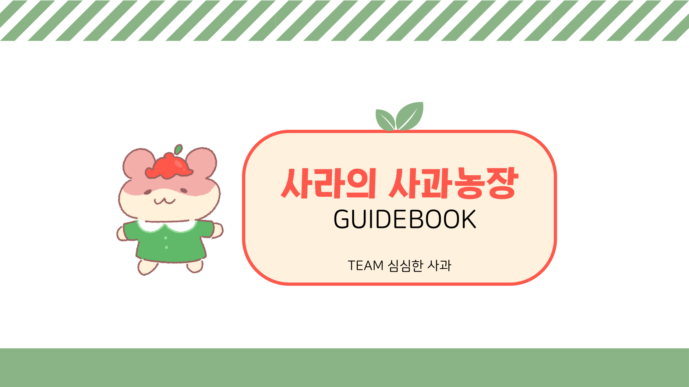

# 사라의 사과농장 — AI 기반 맞춤형 문해력 게임

초등학교 3~4학년의 문해력 학습을 돕기 위해 AI를 활용한 맞춤형 학습과 게임 요소를 결합한 교육 콘텐츠 설계 프로젝트입니다.

| 항목 | 내용 |
| --- | --- |
| 활동 | 이화여자대학교 2023 AIEdu 챌린지그룹 |
| 수상 | 최우수상 |
| 수상일 | 2024년 1월 17일 — 2023년도 프로그램 시상 |
| 팀 | 심심한 사과 — 김혜인, 김효원, 우승아, 최은진 |
| 우승아 역할 | **기획 · 프로토타입 개발 · 평가** |
| 제작 도구 | ProtoPie |

## 문제와 접근

초등학생의 문해력 학습 요구를 조사하고, 수준에 맞는 학습을 지속할 수 있도록 게이미피케이션 콘텐츠를 설계했습니다. ‘사라’와 함께 행성을 정화하고 사과농장을 운영하는 이야기에 문해력 문제 풀이를 연결했습니다.

- 주제 파악·어휘·언어 감수성·매체 등 문해력 요소를 반영한 학습 설계
- 진단평가와 요구분석을 바탕으로 학습자 맞춤형 학습 흐름 기획
- 게임 화면과 상호작용 프로토타입 개발
- 학습 분석과 오답 복습, 단어장, 보상 요소 설계

위 내용은 프로젝트에서 제안·설계한 기능을 포함합니다. 프로토타입은 상용 서비스 전체 기능의 구현을 의미하지 않습니다.

## 최종 산출물과 수상 증빙

- [가이드북 — 공개용](가이드북_공개용.pdf)
- [최종 보고서 — 공개용 본문 발췌](최종보고서_공개용_본문발췌.md)
- [최우수상 상장](최우수상_상장.pdf)

개인정보 보호를 위해 가이드북의 팀원 학번을 가렸습니다. 보고서는 설계 과정·최종 결과물·AI 연계성 본문을 발췌했으며, 팀원 학번·활동일지·예산 내역·개별 학생 인터뷰 및 진단 자료·삽입 이미지는 제외했습니다. 원본 파일은 로컬에 보존되어 있습니다.
